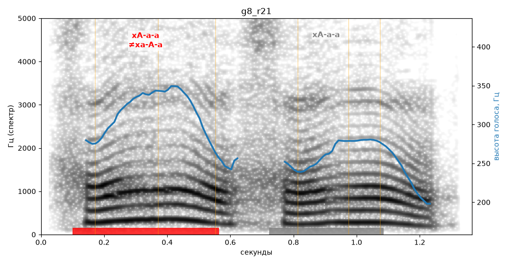

# g8_r21

Естественность (UTMOS): **1.39 из 5** (живой диктор ≈ 4–4.5)
Эталон: Ха-а-а! Ха-а-а!
Распознано: Ха-ха!
Расхождения в словах: «ха-а-а ха-а-а» → «ха-ха»

## Ударения
(где нужно: ruaccent)

| слово | нужно | у голоса | |
|---|---|---|---|
| ха-а-а | хА-а-а | ха-А-а | ✗ ОШИБКА |
| ха-а-а | хА-а-а | ха-а-А | ? не разобрать |

## Интонация
- ✗ «ха-а-а!» — восклицание звучит ровно, без эмоции
- ✗ «ха-а-а!» — восклицание звучит ровно, без эмоции
- Диапазон голоса 8.1 полутонов (живо), средняя высота 279 Гц

## Паузы и темп
- после «ха-а-а!» пауза всего 0.16 с — фразы слипаются
- Темп 7.3 слога/с (быстро)

_Синяя линия — высота голоса. Над словами заглавная буква — где ударение должно быть; красным — голос поставил не туда (уверенно), оранжевым — возможно._
