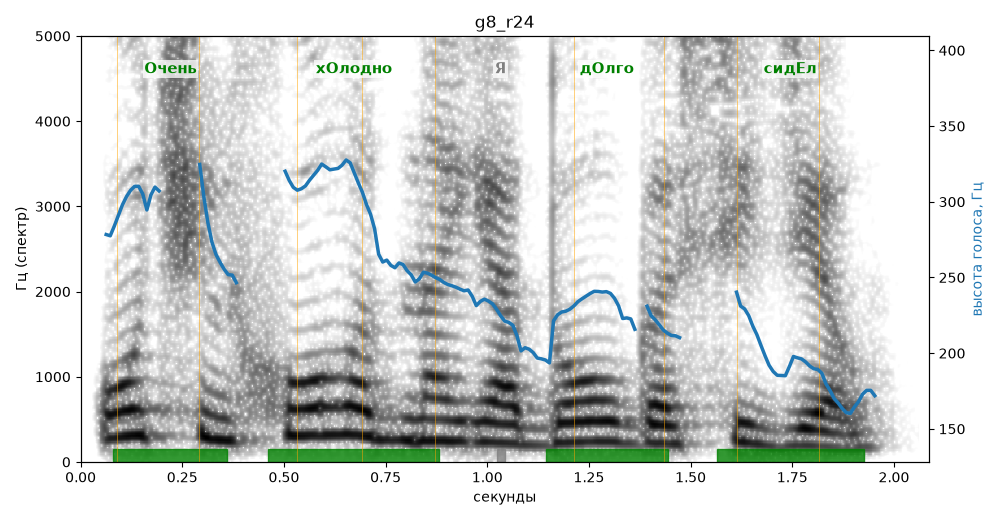

# g8_r24

Естественность (UTMOS): **3.32 из 5** (живой диктор ≈ 4–4.5)
Эталон: Очень холодно! Я долго сидел.
Распознано: Очень холодно я долго сидел.
Слова: все совпали

## Ударения
(где нужно: ruaccent)

| слово | нужно | у голоса | |
|---|---|---|---|
| очень | Очень | Очень | ✓ |
| холодно | хОлодно | хОлодно | ✓ |
| долго | дОлго | дОлго | ✓ |
| сидел | сидЕл | сидЕл | ✓ |

## Интонация
- ✗ «очень холодно!» — восклицание звучит ровно, без эмоции
- ✓ «я долго сидел.» — конец фразы понижается — звучит законченно
- Диапазон голоса 10.8 полутонов (живо), средняя высота 238 Гц

## Паузы и темп
- после «холодно!» пауза всего 0.14 с — фразы слипаются
- Темп 4.9 слога/с (нормально)

_Синяя линия — высота голоса. Над словами заглавная буква — где ударение должно быть; красным — голос поставил не туда (уверенно), оранжевым — возможно._
