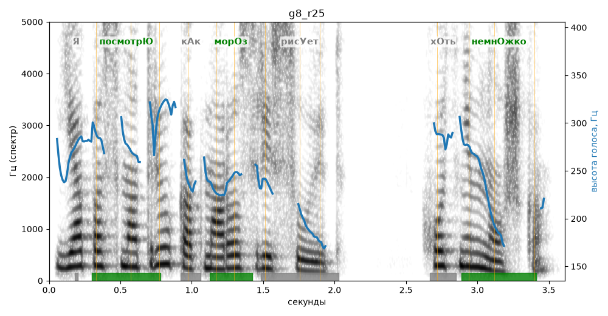

# g8_r25

Естественность (UTMOS): **3.67 из 5** (живой диктор ≈ 4–4.5)
Эталон: Я посмотрю, как мороз рисует. Хоть немножко.
Распознано: Я посмотрю как мороз рисует, хоть немножко.
Слова: все совпали

## Ударения
(где нужно: ruaccent)

| слово | нужно | у голоса | |
|---|---|---|---|
| посмотрю | посмотрЮ | посмотрЮ | ✓ |
| мороз | морОз | морОз | ✓ |
| рисует | рисУет | рИсует | ? не разобрать |
| немножко | немнОжко | немнОжко | ✓ |

## Интонация
- ✓ «я посмотрю как мороз рисует.» — конец фразы понижается — звучит законченно
- ✓ «хоть немножко.» — конец фразы понижается — звучит законченно
- Диапазон голоса 9.7 полутонов (живо), средняя высота 256 Гц

## Паузы и темп
- паузы на своих местах
- Темп 5.0 слога/с (нормально)

_Синяя линия — высота голоса. Над словами заглавная буква — где ударение должно быть; красным — голос поставил не туда (уверенно), оранжевым — возможно._
