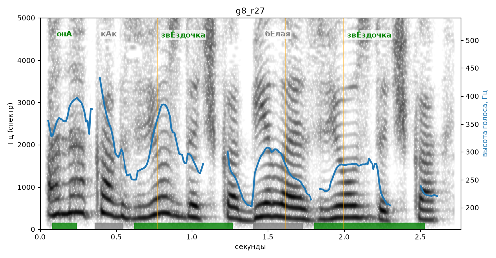

# g8_r27

Естественность (UTMOS): **3.05 из 5** (живой диктор ≈ 4–4.5)
Эталон: Она как звёздочка! Белая звёздочка!
Распознано: Она как звёздочка, белая звёздочка.
Слова: все совпали

## Ударения
(где нужно: ruaccent)

| слово | нужно | у голоса | |
|---|---|---|---|
| она | онА | онА | ✓ |
| звёздочка | звЁздочка | звЁздочка | ✓ |
| белая | бЕлая | — | ? |
| звёздочка | звЁздочка | звЁздочка | ✓ |

## Интонация
- ✗ «она как звёздочка!» — восклицание звучит ровно, без эмоции
- ✗ «белая звёздочка!» — восклицание звучит ровно, без эмоции
- Диапазон голоса 10.1 полутонов (живо), средняя высота 278 Гц

## Паузы и темп
- после «звёздочка!» пауза всего 0.14 с — фразы слипаются
- Темп 4.5 слога/с (нормально)

_Синяя линия — высота голоса. Над словами заглавная буква — где ударение должно быть; красным — голос поставил не туда (уверенно), оранжевым — возможно._
