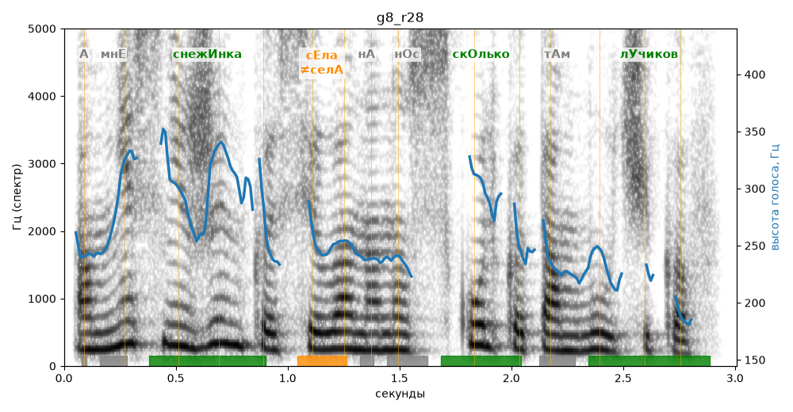

# g8_r28

Естественность (UTMOS): **3.19 из 5** (живой диктор ≈ 4–4.5)
Эталон: А мне снежинка села на нос! Сколько там лучиков?
Распознано: А мне снежинка села на нос сколько там лучиков.
Слова: все совпали

## Ударения
(где нужно: ruaccent)

| слово | нужно | у голоса | |
|---|---|---|---|
| снежинка | снежИнка | снежИнка | ✓ |
| села | сЕла | селА | ✗? возможно — послушать |
| сколько | скОлько | скОлько | ✓ |
| лучиков | лУчиков | лУчиков | ✓ |

## Интонация
- ✓ «а мне снежинка села на нос!» — выделено слово «снежинка» (+4.1 пт)
- ✗ «сколько там лучиков?» — конец фразы не понижается — звучит незаконченно / как перечисление
- Диапазон голоса 7.6 полутонов (живо), средняя высота 248 Гц

## Паузы и темп
- после «нос!» пауза всего 0.06 с — фразы слипаются
- Темп 5.3 слога/с (нормально)

_Синяя линия — высота голоса. Над словами заглавная буква — где ударение должно быть; красным — голос поставил не туда (уверенно), оранжевым — возможно._
