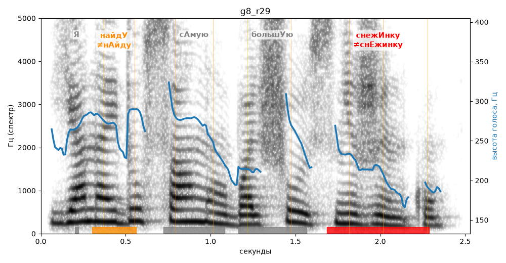

# g8_r29

Естественность (UTMOS): **3.29 из 5** (живой диктор ≈ 4–4.5)
Эталон: Я найду самую большую снежинку!
Распознано: Я найду самую большую снежинку.
Слова: все совпали

## Ударения
(где нужно: ruaccent)

| слово | нужно | у голоса | |
|---|---|---|---|
| найду | найдУ | нАйду | ✗? возможно — послушать |
| самую | сАмую | — | ? |
| большую | большУю | — | ? |
| снежинку | снежИнку | снЕжинку | ✗ ОШИБКА |

## Интонация
- ✗ «я найду самую большую снежинку!» — восклицание звучит ровно, без эмоции
- Диапазон голоса 7.7 полутонов (живо), средняя высота 240 Гц

## Паузы и темп
- паузы на своих местах
- Темп 4.7 слога/с (нормально)

_Синяя линия — высота голоса. Над словами заглавная буква — где ударение должно быть; красным — голос поставил не туда (уверенно), оранжевым — возможно._
