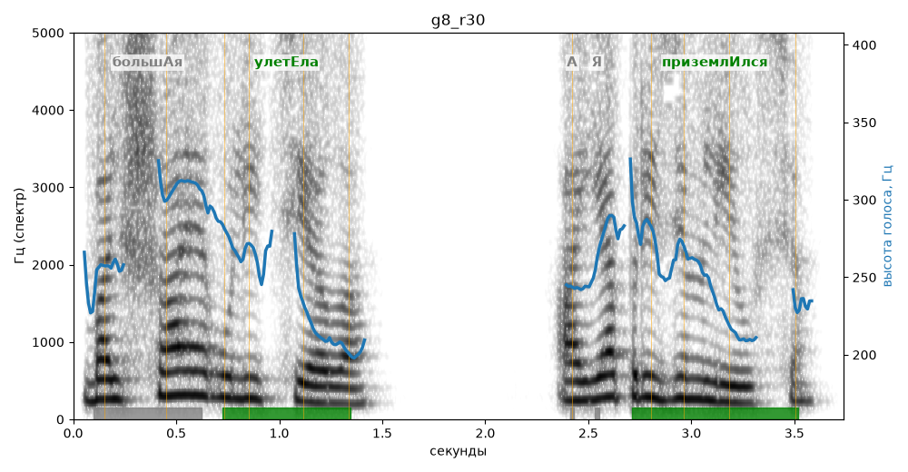

# g8_r30

Естественность (UTMOS): **3.22 из 5** (живой диктор ≈ 4–4.5)
Эталон: Большая улетела. А я приземлился.
Распознано: Большая улетела, а я приземлился.
Слова: все совпали

## Ударения
(где нужно: ruaccent)

| слово | нужно | у голоса | |
|---|---|---|---|
| большая | большАя | — | ? |
| улетела | улетЕла | улетЕла | ✓ |
| приземлился | приземлИлся | приземлИлся | ✓ |

## Интонация
- ✓ «большая улетела.» — конец фразы понижается — звучит законченно
- ✓ «а я приземлился.» — конец фразы понижается — звучит законченно
- Диапазон голоса 7.1 полутонов (живо), средняя высота 257 Гц

## Паузы и темп
- паузы на своих местах
- Темп 5.0 слога/с (нормально)

_Синяя линия — высота голоса. Над словами заглавная буква — где ударение должно быть; красным — голос поставил не туда (уверенно), оранжевым — возможно._
