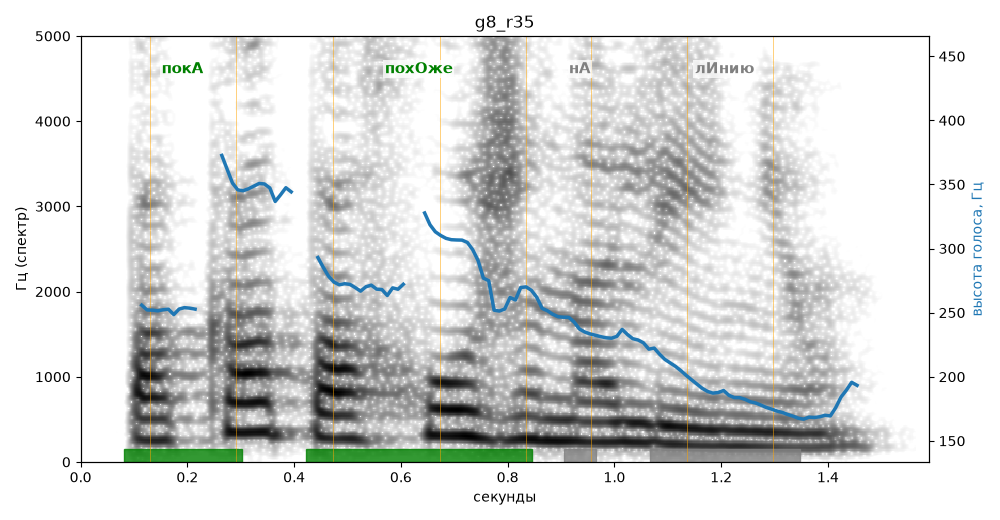

# g8_r35

Естественность (UTMOS): **3.5 из 5** (живой диктор ≈ 4–4.5)
Эталон: Пока похоже на линию.
Распознано: Пока, похоже на линию.
Слова: все совпали

## Ударения
(где нужно: ruaccent)

| слово | нужно | у голоса | |
|---|---|---|---|
| пока | покА | покА | ✓ |
| похоже | похОже | похОже | ✓ |
| линию | лИнию | — | ? |

## Интонация
- ✓ «пока похоже на линию.» — конец фразы понижается — звучит законченно
- Диапазон голоса 12.4 полутонов (живо), средняя высота 252 Гц

## Паузы и темп
- паузы на своих местах
- Темп 6.3 слога/с (нормально)

_Синяя линия — высота голоса. Над словами заглавная буква — где ударение должно быть; красным — голос поставил не туда (уверенно), оранжевым — возможно._
