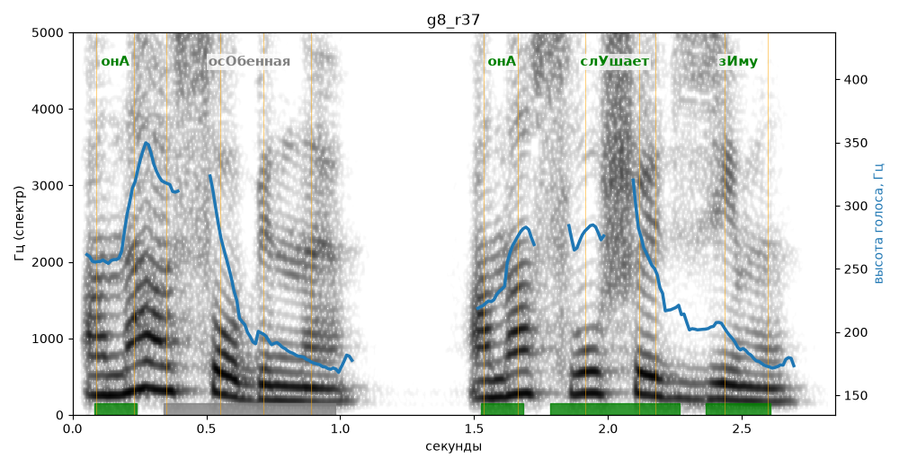

# g8_r37

Естественность (UTMOS): **2.87 из 5** (живой диктор ≈ 4–4.5)
Эталон: Она особенная. Она слушает зиму.
Распознано: Она особенная. Она слушает зиму.
Слова: все совпали

## Ударения
(где нужно: ruaccent)

| слово | нужно | у голоса | |
|---|---|---|---|
| она | онА | онА | ✓ |
| особенная | осОбенная | — | ? |
| она | онА | онА | ✓ |
| слушает | слУшает | слУшает | ✓ |
| зиму | зИму | зИму | ✓ |

## Интонация
- ✗ «она особенная.» — конец фразы не понижается — звучит незаконченно / как перечисление
- ✓ «она слушает зиму.» — конец фразы понижается — звучит законченно
- Диапазон голоса 10.8 полутонов (живо), средняя высота 220 Гц

## Паузы и темп
- паузы на своих местах
- Темп 6.5 слога/с (нормально)

_Синяя линия — высота голоса. Над словами заглавная буква — где ударение должно быть; красным — голос поставил не туда (уверенно), оранжевым — возможно._
