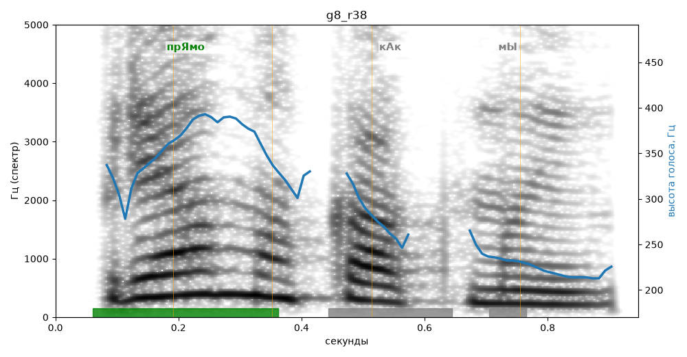

# g8_r38

Естественность (UTMOS): **2.95 из 5** (живой диктор ≈ 4–4.5)
Эталон: Прямо как мы!
Распознано: прямо как мы.
Слова: все совпали

## Ударения
(где нужно: ruaccent)

| слово | нужно | у голоса | |
|---|---|---|---|
| прямо | прЯмо | прЯмо | ✓ |

## Интонация
- ✓ «прямо как мы!» — выделено слово «прямо» (+2.7 пт)
- Диапазон голоса 10.4 полутонов (живо), средняя высота 301 Гц

## Паузы и темп
- паузы на своих местах
- Темп 5.7 слога/с (нормально)

_Синяя линия — высота голоса. Над словами заглавная буква — где ударение должно быть; красным — голос поставил не туда (уверенно), оранжевым — возможно._
