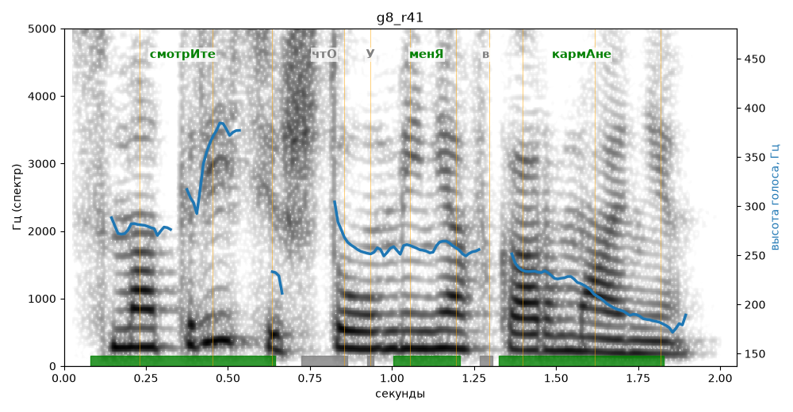

# g8_r41

Естественность (UTMOS): **3.05 из 5** (живой диктор ≈ 4–4.5)
Эталон: Смотрите, что у меня в кармане!
Распознано: Смотрите, что у меня в кармане.
Слова: все совпали

## Ударения
(где нужно: ruaccent)

| слово | нужно | у голоса | |
|---|---|---|---|
| смотрите | смотрИте | смотрИте | ✓ |
| меня | менЯ | менЯ | ✓ |
| кармане | кармАне | кармАне | ✓ |

## Интонация
- ✓ «смотрите что у меня в кармане!» — выделено слово «смотрите» (+6.5 пт)
- Диапазон голоса 12.4 полутонов (живо), средняя высота 253 Гц

## Паузы и темп
- паузы на своих местах
- Темп 6.3 слога/с (нормально)

_Синяя линия — высота голоса. Над словами заглавная буква — где ударение должно быть; красным — голос поставил не туда (уверенно), оранжевым — возможно._
