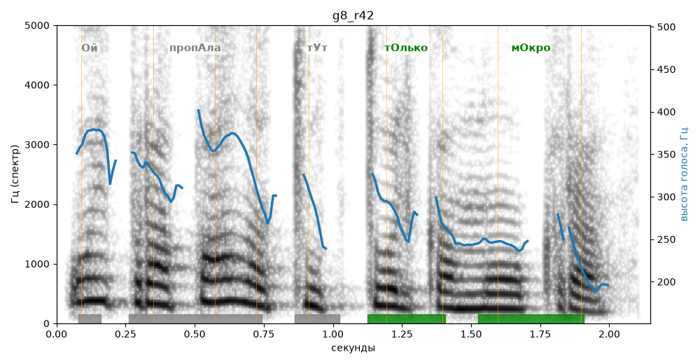

# g8_r42

Естественность (UTMOS): **1.85 из 5** (живой диктор ≈ 4–4.5)
Эталон: Ой! Пропала! Тут только мокро!
Распознано: Ой, пропала тут только мокра.
Расхождения в словах: «мокро» → «мокра»

## Ударения
(где нужно: ruaccent)

| слово | нужно | у голоса | |
|---|---|---|---|
| пропала | пропАла | пропалА | ? не разобрать |
| только | тОлько | тОлько | ✓ |
| мокро | мОкро | мОкро | ✓ |

## Интонация
- ✓ «пропала!» — выделено слово «пропала» (+2.2 пт)
- ✓ «тут только мокро!» — выделено слово «тут» (+2.1 пт)
- Диапазон голоса 11.1 полутонов (живо), средняя высота 293 Гц

## Паузы и темп
- после «ой!» пауза всего 0.10 с — фразы слипаются
- после «пропала!» пауза всего 0.12 с — фразы слипаются
- Темп 4.9 слога/с (нормально)

_Синяя линия — высота голоса. Над словами заглавная буква — где ударение должно быть; красным — голос поставил не туда (уверенно), оранжевым — возможно._
