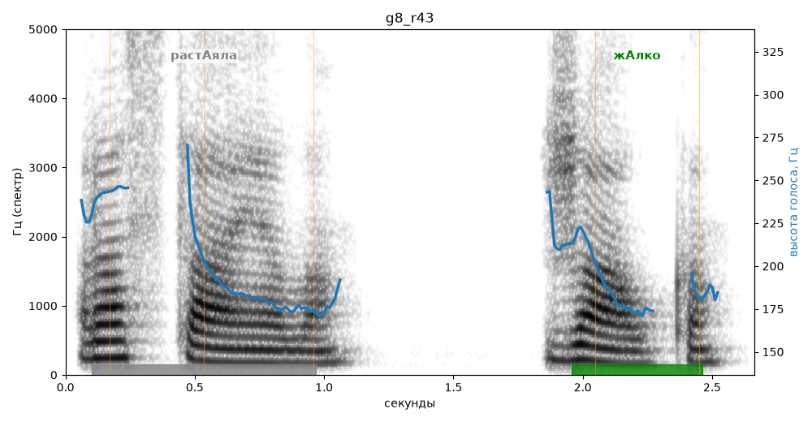

# g8_r43

Естественность (UTMOS): **2.41 из 5** (живой диктор ≈ 4–4.5)
Эталон: Растаяла. Жалко.
Распознано: Растаяла. Жалко.
Слова: все совпали

## Ударения
(где нужно: ruaccent)

| слово | нужно | у голоса | |
|---|---|---|---|
| растаяла | растАяла | — | ? |
| жалко | жАлко | жАлко | ✓ |

## Интонация
- ✗ «растаяла.» — конец фразы не понижается — звучит незаконченно / как перечисление
- Диапазон голоса 6.0 полутонов (нормально), средняя высота 186 Гц

## Паузы и темп
- паузы на своих местах
- Темп 3.6 слога/с (медленно)

_Синяя линия — высота голоса. Над словами заглавная буква — где ударение должно быть; красным — голос поставил не туда (уверенно), оранжевым — возможно._
