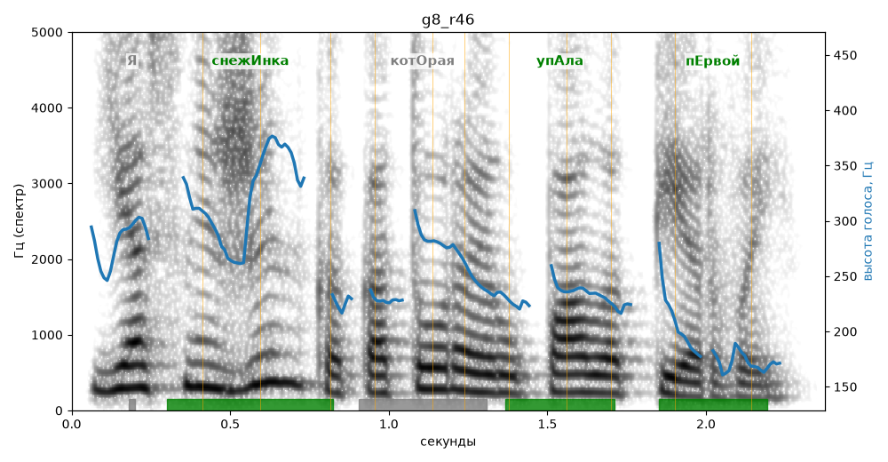

# g8_r46

Естественность (UTMOS): **3.4 из 5** (живой диктор ≈ 4–4.5)
Эталон: Я снежинка, которая упала первой.
Распознано: Я снежинка, которая упала первой.
Слова: все совпали

## Ударения
(где нужно: ruaccent)

| слово | нужно | у голоса | |
|---|---|---|---|
| снежинка | снежИнка | снежИнка | ✓ |
| которая | котОрая | — | ? |
| упала | упАла | упАла | ✓ |
| первой | пЕрвой | пЕрвой | ✓ |

## Интонация
- ✓ «я снежинка которая упала первой.» — конец фразы понижается — звучит законченно
- Диапазон голоса 13.0 полутонов (живо), средняя высота 238 Гц

## Паузы и темп
- паузы на своих местах
- Темп 5.5 слога/с (нормально)

_Синяя линия — высота голоса. Над словами заглавная буква — где ударение должно быть; красным — голос поставил не туда (уверенно), оранжевым — возможно._
