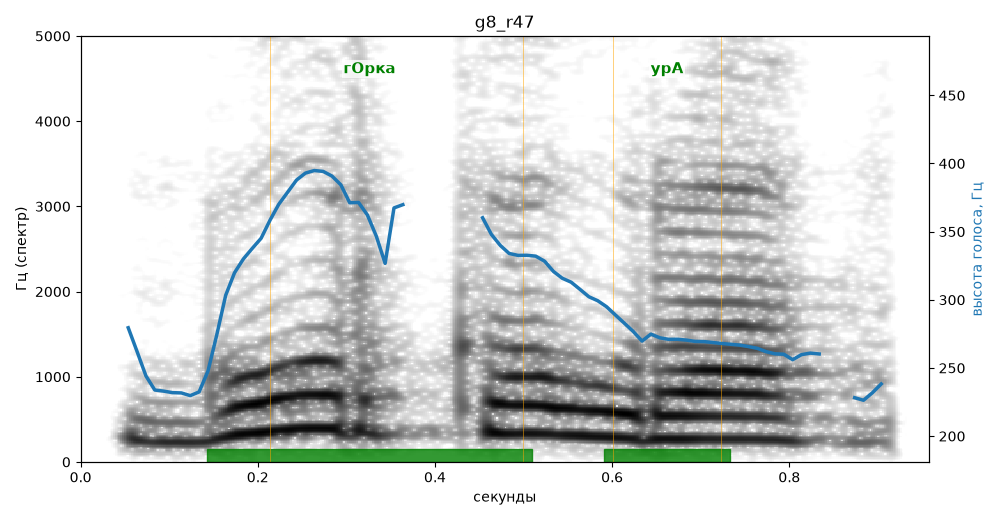

# g8_r47

Естественность (UTMOS): **1.78 из 5** (живой диктор ≈ 4–4.5)
Эталон: Горка! Ура!
Распознано: Горько, ура!
Расхождения в словах: «горка» → «горько»

## Ударения
(где нужно: ruaccent)

| слово | нужно | у голоса | |
|---|---|---|---|
| горка | гОрка | гОрка | ✓ |
| ура | урА | урА | ✓ |

## Интонация
- Диапазон голоса 9.0 полутонов (живо), средняя высота 283 Гц

## Паузы и темп
- после «горка!» пауза всего 0.08 с — фразы слипаются
- Темп 6.8 слога/с (быстро)

_Синяя линия — высота голоса. Над словами заглавная буква — где ударение должно быть; красным — голос поставил не туда (уверенно), оранжевым — возможно._
