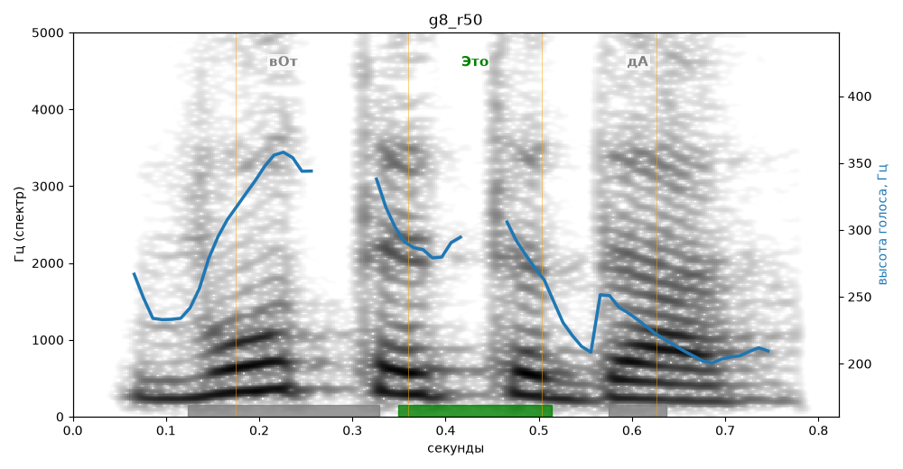

# g8_r50

Естественность (UTMOS): **3.17 из 5** (живой диктор ≈ 4–4.5)
Эталон: Вот это да!
Распознано: Вот это да.
Слова: все совпали

## Ударения
(где нужно: ruaccent)

| слово | нужно | у голоса | |
|---|---|---|---|
| это | Это | Это | ✓ |

## Интонация
- ✓ «вот это да!» — выделено слово «вот» (+2.7 пт)
- Диапазон голоса 9.2 полутонов (живо), средняя высота 251 Гц

## Паузы и темп
- паузы на своих местах
- Темп 7.8 слога/с (быстро)

_Синяя линия — высота голоса. Над словами заглавная буква — где ударение должно быть; красным — голос поставил не туда (уверенно), оранжевым — возможно._
