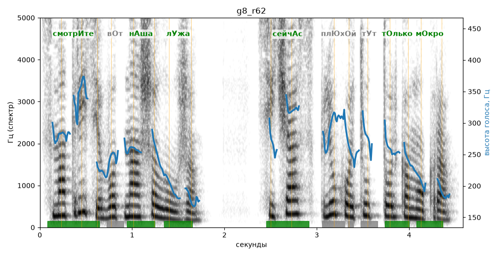

# g8_r62

Естественность (UTMOS): **3.51 из 5** (живой диктор ≈ 4–4.5)
Эталон: Смотрите, вот наша лужа. Сейчас — плюх! Ой! Тут только мокро!
Распознано: Смотрите вот наше лужа. Сейчас плюхой тут только мокро.
Расхождения в словах: «наша» → «наше»; «плюх ой» → «плюхой»

## Ударения
(где нужно: ruaccent)

| слово | нужно | у голоса | |
|---|---|---|---|
| смотрите | смотрИте | смотрИте | ✓ |
| наша | нАша | нАша | ✓ |
| лужа | лУжа | лУжа | ✓ |
| сейчас | сейчАс | сейчАс | ✓ |
| только | тОлько | тОлько | ✓ |
| мокро | мОкро | мОкро | ✓ |

## Интонация
- ✓ «смотрите вот наша лужа.» — конец фразы понижается — звучит законченно
- ✗ «сейчас плюх!» — восклицание звучит ровно, без эмоции
- ✓ «тут только мокро!» — выделено слово «тут» (+2.6 пт)
- Диапазон голоса 10.7 полутонов (живо), средняя высота 254 Гц

## Паузы и темп
- после «плюх!» пауза всего 0.04 с — фразы слипаются
- после «ой!» пауза всего 0.08 с — фразы слипаются
- Темп 4.9 слога/с (нормально)

_Синяя линия — высота голоса. Над словами заглавная буква — где ударение должно быть; красным — голос поставил не туда (уверенно), оранжевым — возможно._
