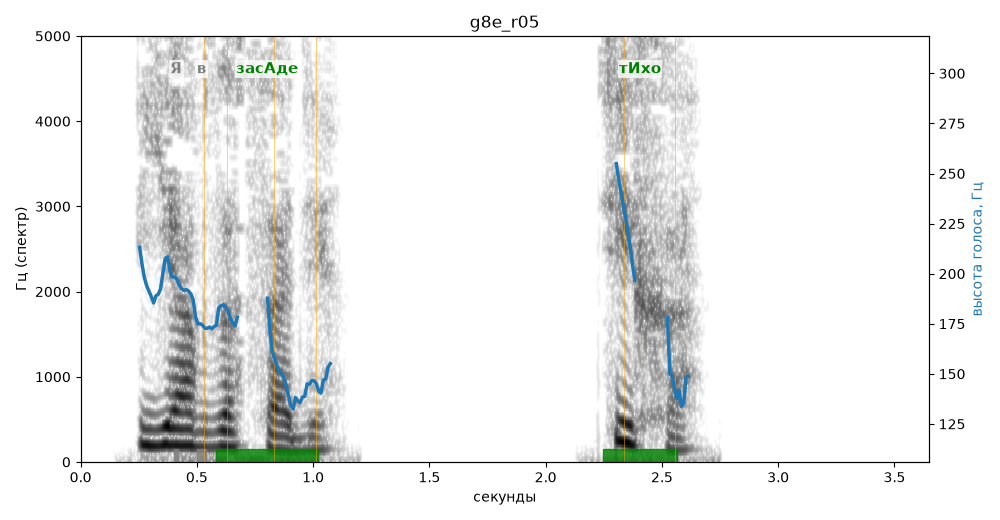

# g8e_r05

Голос: **edge:ru-RU-SvetlanaNeural** · длительность 3.6 с
Естественность (UTMOS): **3.7 из 5** (живой диктор ≈ 4–4.5)
Эталон: Я в засаде. Тихо!
Распознано: Я в засаде. Тихо.
Слова: все совпали

## Ударения
(где нужно: ruaccent)

| слово | нужно | у голоса | |
|---|---|---|---|
| засаде | засАде | засАде | ✓ |
| тихо | тИхо | тИхо | ✓ |

## Интонация
- ✓ «я в засаде.» — конец фразы понижается — звучит законченно
- Диапазон голоса 8.7 полутонов (живо), средняя высота 175 Гц

## Паузы и темп
- паузы на своих местах
- Темп 6.4 слога/с (нормально)

_Синяя линия — высота голоса. Над словами заглавная буква — где ударение должно быть; красным — голос поставил не туда (уверенно), оранжевым — возможно._
