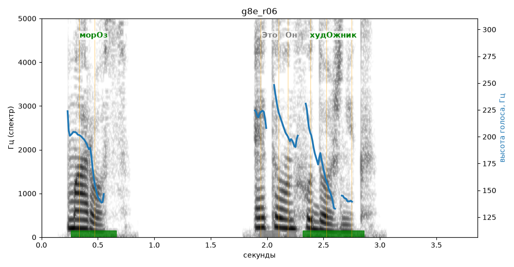

# g8e_r06

Голос: **edge:ru-RU-SvetlanaNeural** · длительность 3.9 с
Естественность (UTMOS): **3.84 из 5** (живой диктор ≈ 4–4.5)
Эталон: Мороз! Это он художник!
Распознано: Мороз. Это он художник.
Слова: все совпали

## Ударения
(где нужно: ruaccent)

| слово | нужно | у голоса | |
|---|---|---|---|
| мороз | морОз | морОз | ✓ |
| это | Это | этО | ? не разобрать |
| художник | худОжник | худОжник | ✓ |

## Интонация
- ✓ «это он художник!» — выделено слово «это» (+2.0 пт)
- Диапазон голоса 8.3 полутонов (живо), средняя высота 196 Гц

## Паузы и темп
- паузы на своих местах
- Темп 6.0 слога/с (нормально)

_Синяя линия — высота голоса. Над словами заглавная буква — где ударение должно быть; красным — голос поставил не туда (уверенно), оранжевым — возможно._
