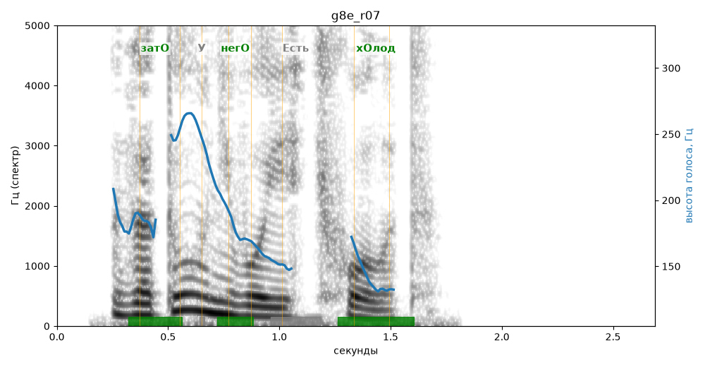

# g8e_r07

Голос: **edge:ru-RU-SvetlanaNeural** · длительность 2.7 с
Естественность (UTMOS): **4.0 из 5** (живой диктор ≈ 4–4.5)
Эталон: Зато у него есть холод.
Распознано: Зато у него есть холод.
Слова: все совпали

## Ударения
(где нужно: ruaccent)

| слово | нужно | у голоса | |
|---|---|---|---|
| зато | затО | затО | ✓ |
| него | негО | негО | ✓ |
| холод | хОлод | хОлод | ✓ |

## Интонация
- ✓ «зато у него есть холод.» — конец фразы понижается — звучит законченно
- Диапазон голоса 11.8 полутонов (живо), средняя высота 176 Гц

## Паузы и темп
- паузы на своих местах
- Темп 6.2 слога/с (нормально)

_Синяя линия — высота голоса. Над словами заглавная буква — где ударение должно быть; красным — голос поставил не туда (уверенно), оранжевым — возможно._
