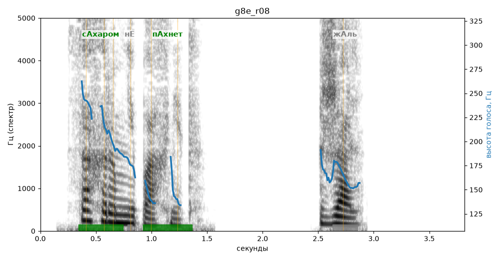

# g8e_r08

Голос: **edge:ru-RU-SvetlanaNeural** · длительность 3.8 с
Естественность (UTMOS): **3.81 из 5** (живой диктор ≈ 4–4.5)
Эталон: Сахаром не пахнет. Жаль.
Распознано: Сахаром не пахнет. Жаль.
Слова: все совпали

## Ударения
(где нужно: ruaccent)

| слово | нужно | у голоса | |
|---|---|---|---|
| сахаром | сАхаром | сАхаром | ✓ |
| пахнет | пАхнет | пАхнет | ✓ |

## Интонация
- ✓ «сахаром не пахнет.» — конец фразы понижается — звучит законченно
- Диапазон голоса 9.9 полутонов (живо), средняя высота 172 Гц

## Паузы и темп
- паузы на своих местах
- Темп 5.6 слога/с (нормально)

_Синяя линия — высота голоса. Над словами заглавная буква — где ударение должно быть; красным — голос поставил не туда (уверенно), оранжевым — возможно._
