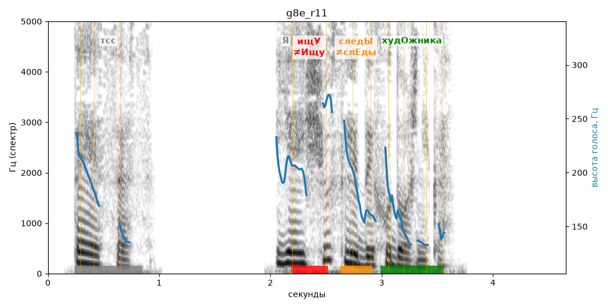

# g8e_r11

Голос: **edge:ru-RU-SvetlanaNeural** · длительность 4.7 с
Естественность (UTMOS): **4.12 из 5** (живой диктор ≈ 4–4.5)
Эталон: Тсс! Я ищу следы художника.
Распознано: ТСС. Я ищу следы художника.
Слова: все совпали

## Ударения
(где нужно: ruaccent)

| слово | нужно | у голоса | |
|---|---|---|---|
| ищу | ищУ | Ищу | ✗ ОШИБКА |
| следы | следЫ | слЕды | ✗? возможно — послушать |
| художника | худОжника | худОжника | ✓ |

## Интонация
- ✓ «я ищу следы художника.» — конец фразы понижается — звучит законченно
- Диапазон голоса 11.4 полутонов (живо), средняя высота 182 Гц

## Паузы и темп
- паузы на своих местах
- Темп 5.4 слога/с (нормально)

_Синяя линия — высота голоса. Над словами заглавная буква — где ударение должно быть; красным — голос поставил не туда (уверенно), оранжевым — возможно._
