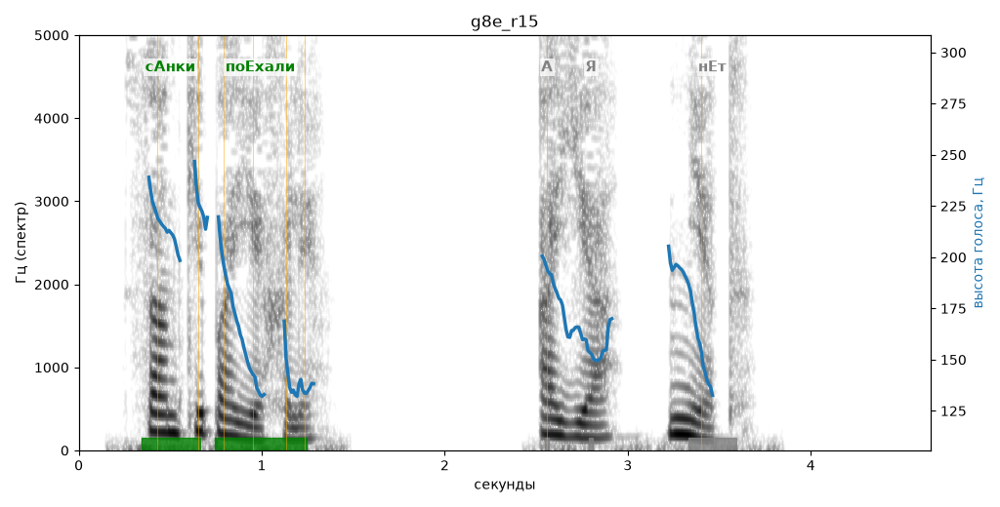

# g8e_r15

Голос: **edge:ru-RU-SvetlanaNeural** · длительность 4.7 с
Естественность (UTMOS): **4.16 из 5** (живой диктор ≈ 4–4.5)
Эталон: Санки поехали. А я — нет.
Распознано: Санки поехали. А я, нет.
Слова: все совпали

## Ударения
(где нужно: ruaccent)

| слово | нужно | у голоса | |
|---|---|---|---|
| санки | сАнки | сАнки | ✓ |
| поехали | поЕхали | поЕхали | ✓ |

## Интонация
- ✓ «санки поехали.» — конец фразы понижается — звучит законченно
- Диапазон голоса 9.0 полутонов (живо), средняя высота 169 Гц

## Паузы и темп
- паузы на своих местах
- Темп 6.6 слога/с (быстро)

_Синяя линия — высота голоса. Над словами заглавная буква — где ударение должно быть; красным — голос поставил не туда (уверенно), оранжевым — возможно._
