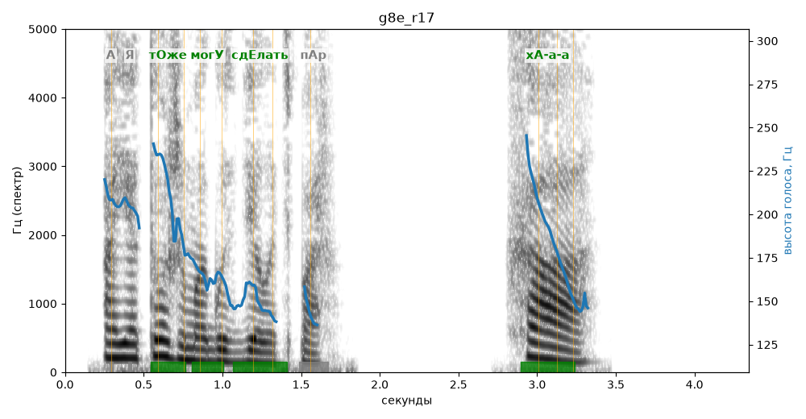

# g8e_r17

Голос: **edge:ru-RU-SvetlanaNeural** · длительность 4.3 с
Естественность (UTMOS): **3.89 из 5** (живой диктор ≈ 4–4.5)
Эталон: А я тоже могу сделать пар! Ха-а-а!
Распознано: А я тоже могу сделать пар. Хаа!
Расхождения в словах: «ха-а-а» → «хаа»

## Ударения
(где нужно: ruaccent)

| слово | нужно | у голоса | |
|---|---|---|---|
| тоже | тОже | тОже | ✓ |
| могу | могУ | могУ | ✓ |
| сделать | сдЕлать | сдЕлать | ✓ |
| ха-а-а | хА-а-а | хА-а-а | ✓ |

## Интонация
- ✓ «а я тоже могу сделать пар!» — выделено слово «тоже» (+6.2 пт)
- ✓ «ха-а-а!» — выделено слово «ха-а-а» (+2.8 пт)
- Диапазон голоса 8.7 полутонов (живо), средняя высота 169 Гц

## Паузы и темп
- паузы на своих местах
- Темп 6.4 слога/с (нормально)

_Синяя линия — высота голоса. Над словами заглавная буква — где ударение должно быть; красным — голос поставил не туда (уверенно), оранжевым — возможно._
