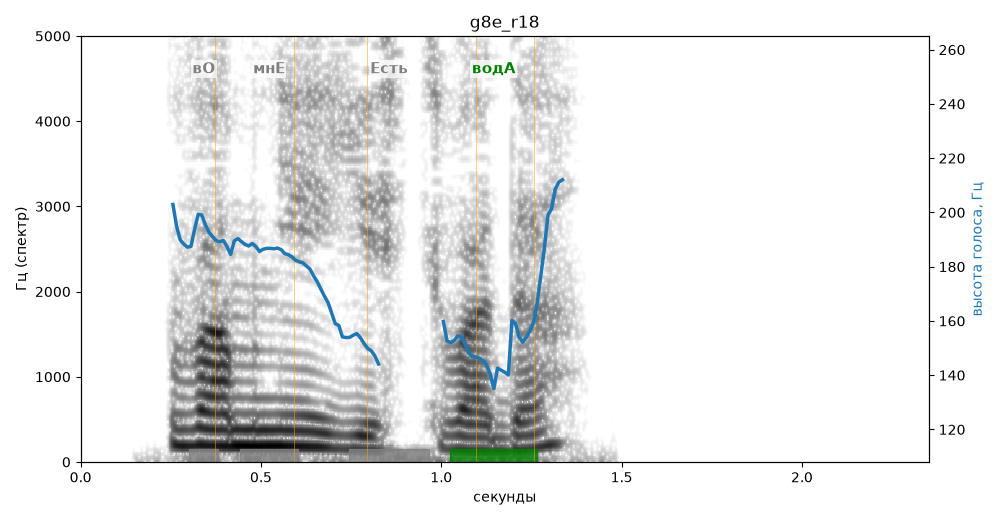

# g8e_r18

Голос: **edge:ru-RU-SvetlanaNeural** · длительность 2.4 с
Естественность (UTMOS): **3.97 из 5** (живой диктор ≈ 4–4.5)
Эталон: Во мне есть вода?
Распознано: Во мне есть вода?
Слова: все совпали

## Ударения
(где нужно: ruaccent)

| слово | нужно | у голоса | |
|---|---|---|---|
| вода | водА | водА | ✓ |

## Интонация
- ✗ «во мне есть вода?» — нет вопросительного подъёма (самое высокое место — «во», в начале) — звучит как утверждение
- Диапазон голоса 5.9 полутонов (нормально), средняя высота 177 Гц

## Паузы и темп
- паузы на своих местах
- Темп 5.2 слога/с (нормально)

_Синяя линия — высота голоса. Над словами заглавная буква — где ударение должно быть; красным — голос поставил не туда (уверенно), оранжевым — возможно._
