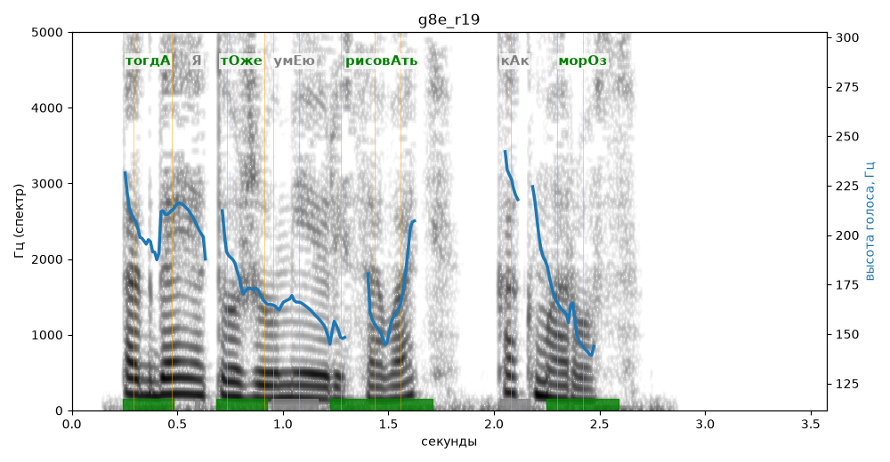

# g8e_r19

Голос: **edge:ru-RU-SvetlanaNeural** · длительность 3.6 с
Естественность (UTMOS): **3.81 из 5** (живой диктор ≈ 4–4.5)
Эталон: Тогда я тоже умею рисовать, как мороз!
Распознано: Тогда я тоже умею рисовать, как мороз.
Слова: все совпали

## Ударения
(где нужно: ruaccent)

| слово | нужно | у голоса | |
|---|---|---|---|
| тогда | тогдА | тогдА | ✓ |
| тоже | тОже | тОже | ✓ |
| умею | умЕю | — | ? |
| рисовать | рисовАть | рисовАть | ✓ |
| мороз | морОз | морОз | ✓ |

## Интонация
- ✓ «тогда я тоже умею рисовать как мороз!» — выделено слово «как» (+5.0 пт)
- Диапазон голоса 7.2 полутонов (живо), средняя высота 172 Гц

## Паузы и темп
- паузы на своих местах
- Темп 5.9 слога/с (нормально)

_Синяя линия — высота голоса. Над словами заглавная буква — где ударение должно быть; красным — голос поставил не туда (уверенно), оранжевым — возможно._
