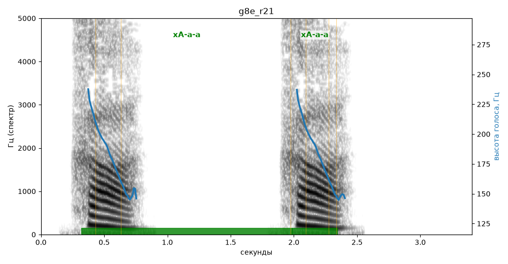

# g8e_r21

Голос: **edge:ru-RU-SvetlanaNeural** · длительность 3.4 с
Естественность (UTMOS): **3.58 из 5** (живой диктор ≈ 4–4.5)
Эталон: Ха-а-а! Ха-а-а!
Распознано: ха
Расхождения в словах: «ха-а-а ха-а-а» → «ха»

## Ударения
(где нужно: ruaccent)

| слово | нужно | у голоса | |
|---|---|---|---|
| ха-а-а | хА-а-а | хА-а-а | ✓ |
| ха-а-а | хА-а-а | хА-а-а | ✓ |

## Интонация
- ✗ «ха-а-а!» — восклицание звучит ровно, без эмоции
- ✓ «ха-а-а!» — выделено слово «ха-а-а» (+3.0 пт)
- Диапазон голоса 7.5 полутонов (живо), средняя высота 178 Гц

## Паузы и темп
- после «ха-а-а!» пауза всего 0.00 с — фразы слипаются
- Темп 3.0 слога/с (медленно)

_Синяя линия — высота голоса. Над словами заглавная буква — где ударение должно быть; красным — голос поставил не туда (уверенно), оранжевым — возможно._
