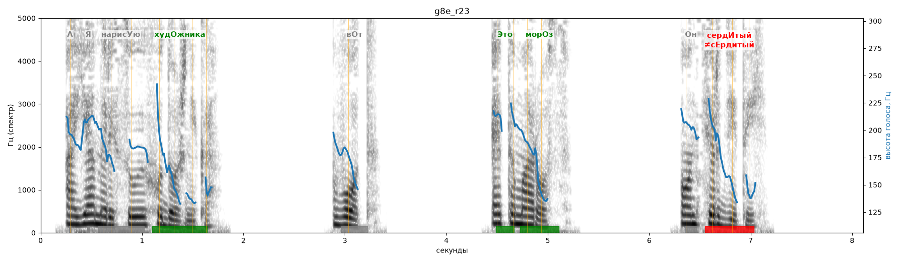

# g8e_r23

Голос: **edge:ru-RU-SvetlanaNeural** · длительность 8.1 с
Естественность (UTMOS): **3.94 из 5** (живой диктор ≈ 4–4.5)
Эталон: А я нарисую художника. Вот. Это Мороз. Он сердитый.
Распознано: А я нарисую художника. Вот. Это Мороз. Он сердитый.
Слова: все совпали

## Ударения
(где нужно: ruaccent)

| слово | нужно | у голоса | |
|---|---|---|---|
| нарисую | нарисУю | — | ? |
| художника | худОжника | худОжника | ✓ |
| это | Это | Это | ✓ |
| мороз | морОз | морОз | ✓ |
| сердитый | сердИтый | сЕрдитый | ✗ ОШИБКА |

## Интонация
- ✓ «а я нарисую художника.» — конец фразы понижается — звучит законченно
- ✓ «это мороз.» — конец фразы понижается — звучит законченно
- ✓ «он сердитый.» — конец фразы понижается — звучит законченно
- Диапазон голоса 7.7 полутонов (живо), средняя высота 184 Гц

## Паузы и темп
- паузы на своих местах
- Темп 6.2 слога/с (нормально)

_Синяя линия — высота голоса. Над словами заглавная буква — где ударение должно быть; красным — голос поставил не туда (уверенно), оранжевым — возможно._
