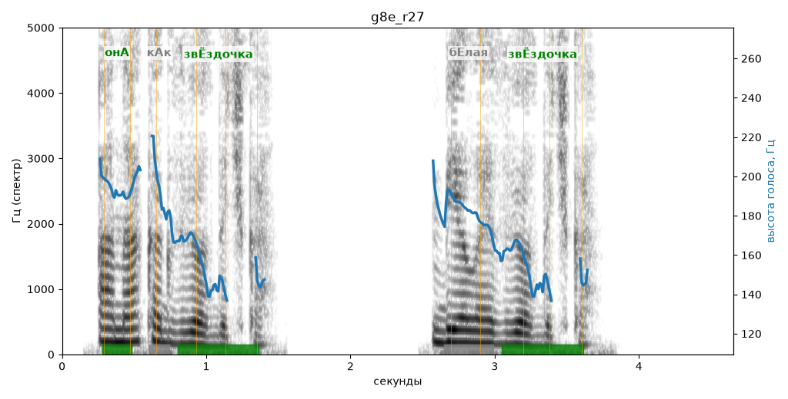

# g8e_r27

Голос: **edge:ru-RU-SvetlanaNeural** · длительность 4.7 с
Естественность (UTMOS): **3.76 из 5** (живой диктор ≈ 4–4.5)
Эталон: Она как звёздочка! Белая звёздочка!
Распознано: Она как звездочка. Белая звездочка.
Слова: все совпали

## Ударения
(где нужно: ruaccent)

| слово | нужно | у голоса | |
|---|---|---|---|
| она | онА | онА | ✓ |
| звёздочка | звЁздочка | звЁздочка | ✓ |
| белая | бЕлая | — | ? |
| звёздочка | звЁздочка | звЁздочка | ✓ |

## Интонация
- ✗ «она как звёздочка!» — восклицание звучит ровно, без эмоции
- ✓ «белая звёздочка!» — выделено слово «белая» (+2.4 пт)
- Диапазон голоса 6.1 полутонов (нормально), средняя высота 170 Гц

## Паузы и темп
- паузы на своих местах
- Темп 5.4 слога/с (нормально)

_Синяя линия — высота голоса. Над словами заглавная буква — где ударение должно быть; красным — голос поставил не туда (уверенно), оранжевым — возможно._
