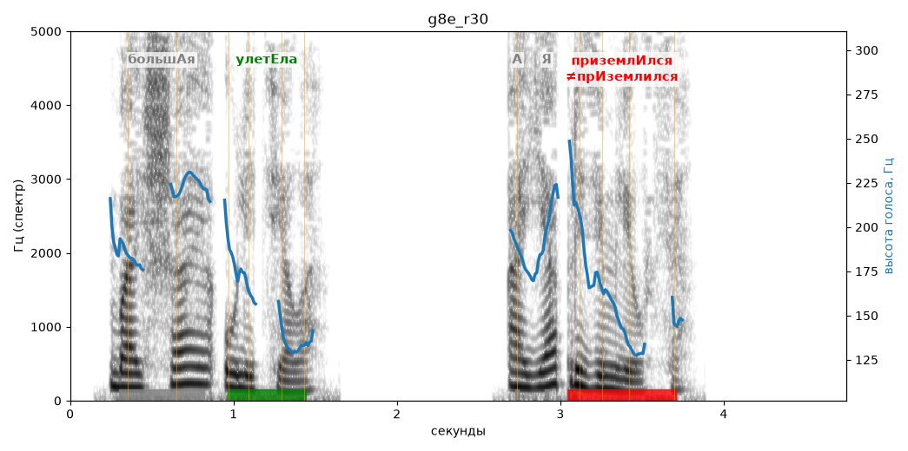

# g8e_r30

Голос: **edge:ru-RU-SvetlanaNeural** · длительность 4.8 с
Естественность (UTMOS): **4.21 из 5** (живой диктор ≈ 4–4.5)
Эталон: Большая улетела. А я приземлился.
Распознано: Большая улетела. А я приземлился.
Слова: все совпали

## Ударения
(где нужно: ruaccent)

| слово | нужно | у голоса | |
|---|---|---|---|
| большая | большАя | — | ? |
| улетела | улетЕла | улетЕла | ✓ |
| приземлился | приземлИлся | прИземлился | ✗ ОШИБКА |

## Интонация
- ✓ «большая улетела.» — конец фразы понижается — звучит законченно
- ✓ «а я приземлился.» — конец фразы понижается — звучит законченно
- Диапазон голоса 9.8 полутонов (живо), средняя высота 176 Гц

## Паузы и темп
- паузы на своих местах
- Темп 5.6 слога/с (нормально)

_Синяя линия — высота голоса. Над словами заглавная буква — где ударение должно быть; красным — голос поставил не туда (уверенно), оранжевым — возможно._
