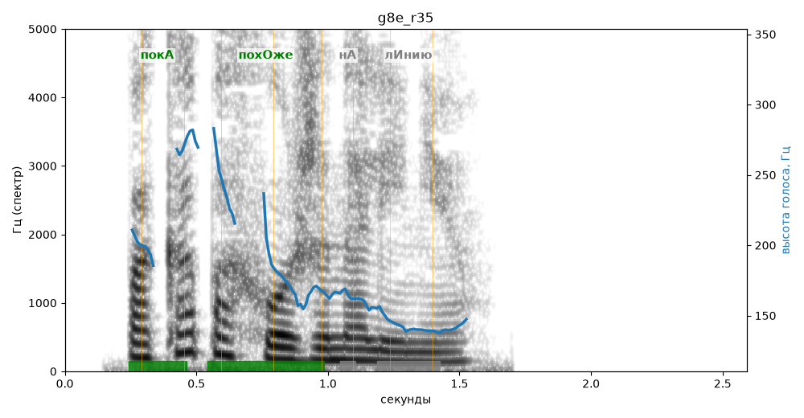

# g8e_r35

Голос: **edge:ru-RU-SvetlanaNeural** · длительность 2.6 с
Естественность (UTMOS): **4.17 из 5** (живой диктор ≈ 4–4.5)
Эталон: Пока похоже на линию.
Распознано: Пока похоже на линию.
Слова: все совпали

## Ударения
(где нужно: ruaccent)

| слово | нужно | у голоса | |
|---|---|---|---|
| пока | покА | покА | ✓ |
| похоже | похОже | похОже | ✓ |
| линию | лИнию | — | ? |

## Интонация
- ✓ «пока похоже на линию.» — конец фразы понижается — звучит законченно
- Диапазон голоса 11.6 полутонов (живо), средняя высота 165 Гц

## Паузы и темп
- паузы на своих местах
- Темп 6.7 слога/с (быстро)

_Синяя линия — высота голоса. Над словами заглавная буква — где ударение должно быть; красным — голос поставил не туда (уверенно), оранжевым — возможно._
