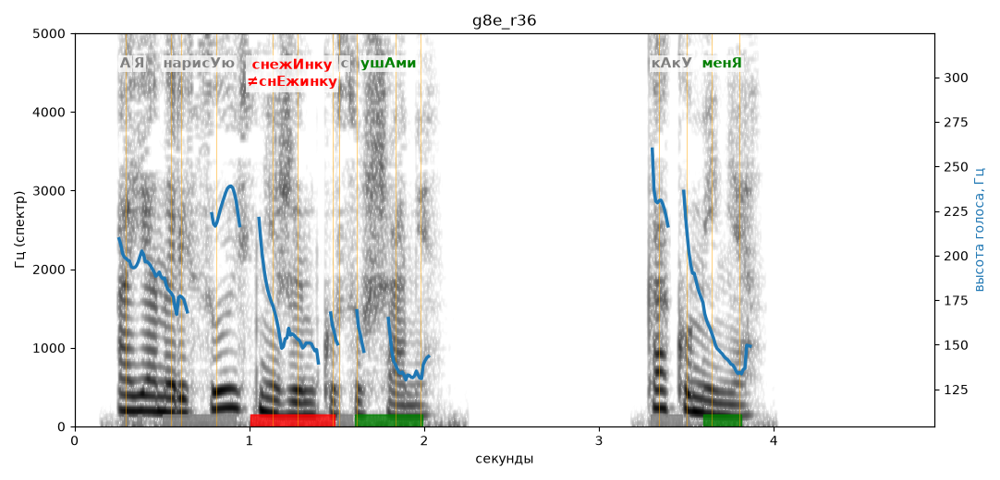

# g8e_r36

Голос: **edge:ru-RU-SvetlanaNeural** · длительность 4.9 с
Естественность (UTMOS): **3.94 из 5** (живой диктор ≈ 4–4.5)
Эталон: А я нарисую снежинку с ушами. Как у меня.
Распознано: А я нарисую снежинку с ушами. Как у меня.
Слова: все совпали

## Ударения
(где нужно: ruaccent)

| слово | нужно | у голоса | |
|---|---|---|---|
| нарисую | нарисУю | — | ? |
| снежинку | снежИнку | снЕжинку | ✗ ОШИБКА |
| ушами | ушАми | ушАми | ✓ |
| меня | менЯ | менЯ | ✓ |

## Интонация
- ✓ «а я нарисую снежинку с ушами.» — конец фразы понижается — звучит законченно
- ✓ «как у меня.» — конец фразы понижается — звучит законченно
- Диапазон голоса 9.7 полутонов (живо), средняя высота 168 Гц

## Паузы и темп
- паузы на своих местах
- Темп 6.7 слога/с (быстро)

_Синяя линия — высота голоса. Над словами заглавная буква — где ударение должно быть; красным — голос поставил не туда (уверенно), оранжевым — возможно._
