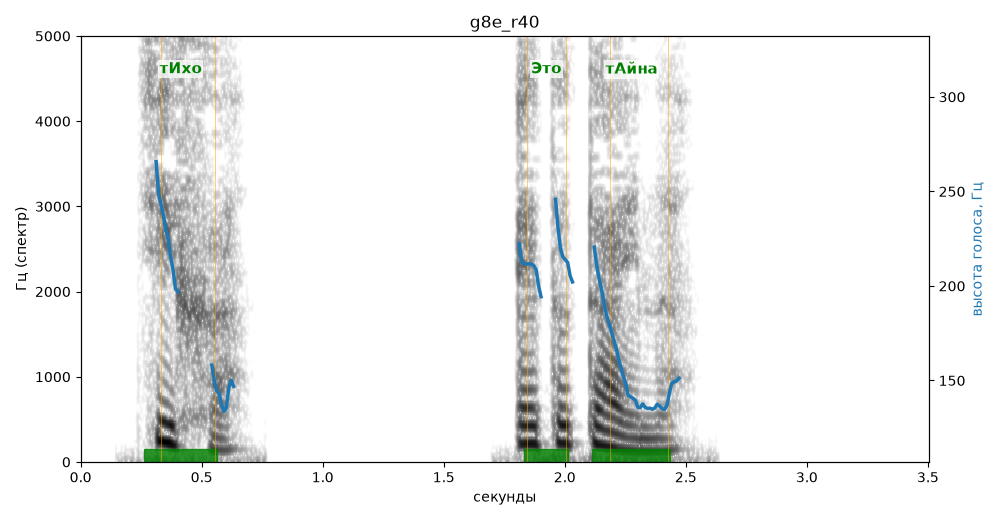

# g8e_r40

Голос: **edge:ru-RU-SvetlanaNeural** · длительность 3.5 с
Естественность (UTMOS): **3.97 из 5** (живой диктор ≈ 4–4.5)
Эталон: Тихо! Это тайна.
Распознано: Тихо. Это тайна.
Слова: все совпали

## Ударения
(где нужно: ruaccent)

| слово | нужно | у голоса | |
|---|---|---|---|
| тихо | тИхо | тИхо | ✓ |
| это | Это | Это | ✓ |
| тайна | тАйна | тАйна | ✓ |

## Интонация
- ✓ «это тайна.» — конец фразы понижается — звучит законченно
- Диапазон голоса 9.9 полутонов (живо), средняя высота 169 Гц

## Паузы и темп
- паузы на своих местах
- Темп 6.6 слога/с (быстро)

_Синяя линия — высота голоса. Над словами заглавная буква — где ударение должно быть; красным — голос поставил не туда (уверенно), оранжевым — возможно._
