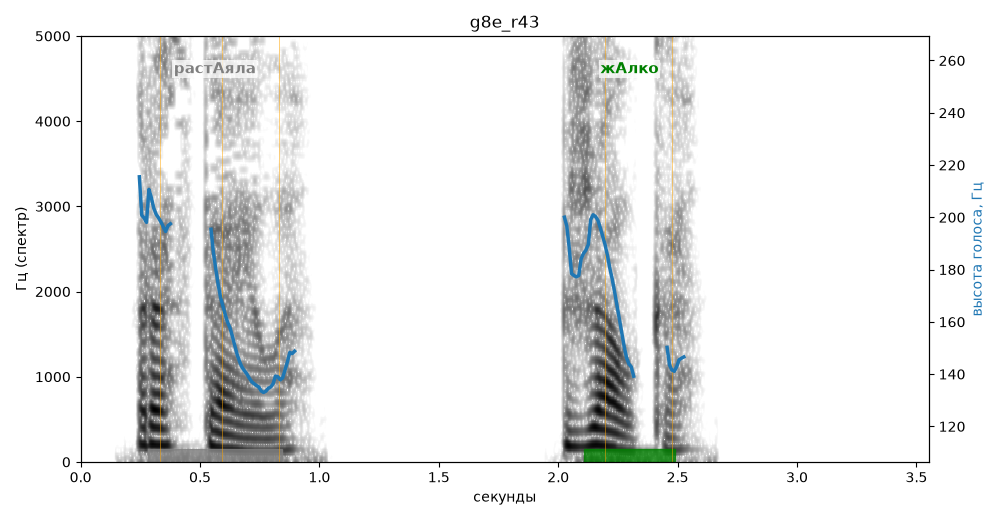

# g8e_r43

Голос: **edge:ru-RU-SvetlanaNeural** · длительность 3.6 с
Естественность (UTMOS): **3.9 из 5** (живой диктор ≈ 4–4.5)
Эталон: Растаяла. Жалко.
Распознано: Растаила. Жалко.
Расхождения в словах: «растаяла» → «растаила»

## Ударения
(где нужно: ruaccent)

| слово | нужно | у голоса | |
|---|---|---|---|
| растаяла | растАяла | — | ? |
| жалко | жАлко | жАлко | ✓ |

## Интонация
- ✗ «растаяла.» — конец фразы не понижается — звучит незаконченно / как перечисление
- Диапазон голоса 6.9 полутонов (нормально), средняя высота 162 Гц

## Паузы и темп
- паузы на своих местах
- Темп 5.3 слога/с (нормально)

_Синяя линия — высота голоса. Над словами заглавная буква — где ударение должно быть; красным — голос поставил не туда (уверенно), оранжевым — возможно._
