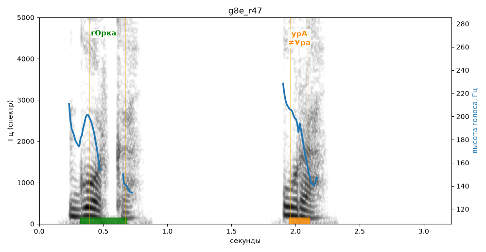

# g8e_r47

Голос: **edge:ru-RU-SvetlanaNeural** · длительность 3.2 с
Естественность (UTMOS): **3.58 из 5** (живой диктор ≈ 4–4.5)
Эталон: Горка! Ура!
Распознано: Горка Ура!
Слова: все совпали

## Ударения
(где нужно: ruaccent)

| слово | нужно | у голоса | |
|---|---|---|---|
| горка | гОрка | гОрка | ✓ |
| ура | урА | Ура | ✗? возможно — послушать |

## Интонация
- Диапазон голоса 7.4 полутонов (живо), средняя высота 183 Гц

## Паузы и темп
- паузы на своих местах
- Темп 7.7 слога/с (быстро)

_Синяя линия — высота голоса. Над словами заглавная буква — где ударение должно быть; красным — голос поставил не туда (уверенно), оранжевым — возможно._
