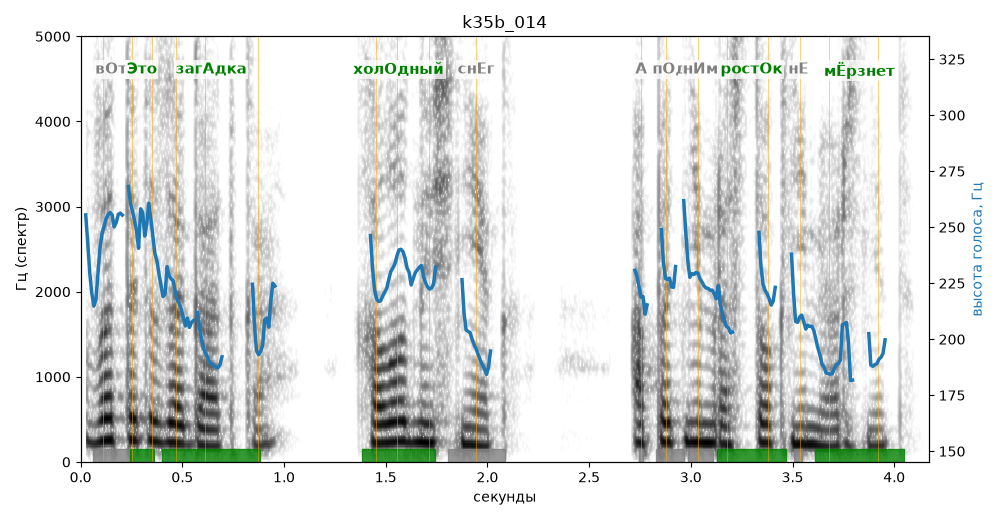

# k35b_014

Голос: **Барсик, сборка 35d** · длительность 4.2 с
Эталон: Вот это загадка. Холодный снег, а под ним росток не мёрзнет.
Распознано: Вот эта загадка, холодный снег, а под ним расток не мёрзнет.
Расхождения в словах: «это» → «эта»; «росток» → «расток»

## Ударения
(где нужно: ruaccent)

| слово | нужно | у голоса | |
|---|---|---|---|
| это | Это | Это | ✓ |
| загадка | загАдка | загАдка | ✓ |
| холодный | холОдный | холОдный | ✓ |
| росток | ростОк | ростОк | ✓ |
| мёрзнет | мЁрзнет | мЁрзнет | ✓ |

## Интонация
- ✓ «вот это загадка.» — конец фразы понижается — звучит законченно
- ✓ «холодный снег а под ним росток не мёрзнет.» — конец фразы понижается — звучит законченно
- Диапазон голоса 5.4 полутонов (нормально), средняя высота 220 Гц

## Паузы и темп
- паузы на своих местах
- Темп 6.4 слога/с (нормально)

_Синяя линия — высота голоса. Над словами заглавная буква — где ударение должно быть; красным — голос поставил не туда (уверенно), оранжевым — возможно._
