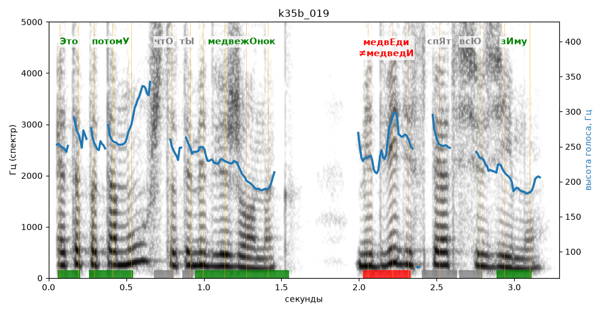

# k35b_019

Голос: **Барсик, сборка 35d** · длительность 3.3 с
Эталон: Это потому, что ты медвежонок. Медведи спят всю зиму!
Распознано: Это потому, что ты медвежонок. Медведи спят всю зиму.
Слова: все совпали

## Ударения
(где нужно: ruaccent)

| слово | нужно | у голоса | |
|---|---|---|---|
| это | Это | Это | ✓ |
| потому | потомУ | потомУ | ✓ |
| медвежонок | медвежОнок | медвежОнок | ✓ |
| медведи | медвЕди | медведИ | ✗ ОШИБКА |
| зиму | зИму | зИму | ✓ |

## Интонация
- ✓ «это потому что ты медвежонок.» — конец фразы понижается — звучит законченно
- ✓ «медведи спят всю зиму!» — выделено слово «медведи» (+2.4 пт)
- Диапазон голоса 8.2 полутонов (живо), средняя высота 240 Гц

## Паузы и темп
- паузы на своих местах
- Темп 7.0 слога/с (быстро)

_Синяя линия — высота голоса. Над словами заглавная буква — где ударение должно быть; красным — голос поставил не туда (уверенно), оранжевым — возможно._
