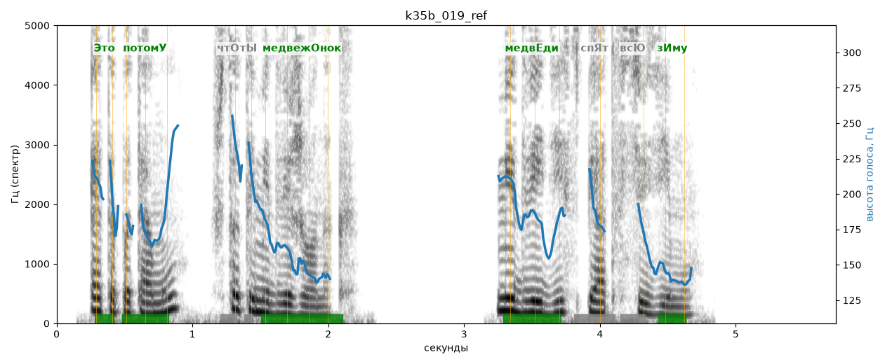

# k35b_019_ref

Голос: **edge:ru-RU-SvetlanaNeural** · длительность 5.7 с
Эталон: Это потому, что ты медвежонок. Медве́ди спят всю зи́му!
Распознано: Это потому, что ты медвежонок. Медведи спят всю зиму.
Расхождения в словах: «медве ди» → «медведи»; «зи му» → «зиму»

## Ударения
(где нужно: ruaccent)

| слово | нужно | у голоса | |
|---|---|---|---|
| это | Это | Это | ✓ |
| потому | потомУ | потомУ | ✓ |
| медвежонок | медвежОнок | медвежОнок | ✓ |
| медведи | медвЕди | медвЕди | ✓ |
| зиму | зИму | зИму | ✓ |

## Интонация
- ✓ «это потому что ты медвежонок.» — конец фразы понижается — звучит законченно
- ✗ «медведи спят всю зиму!» — восклицание звучит ровно, без эмоции
- Диапазон голоса 8.6 полутонов (живо), средняя высота 176 Гц

## Паузы и темп
- паузы на своих местах
- Темп 6.5 слога/с (нормально)

_Синяя линия — высота голоса. Над словами заглавная буква — где ударение должно быть; красным — голос поставил не туда (уверенно), оранжевым — возможно._
