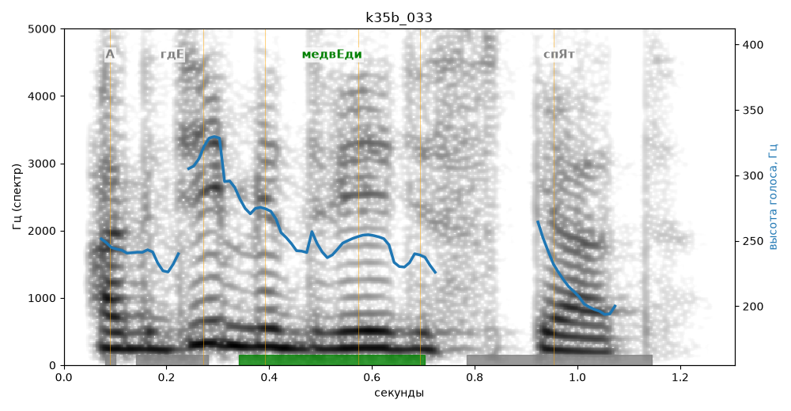

# k35b_033

Голос: **Барсик, сборка 35d** · длительность 1.3 с
Эталон: А где медведи спят?
Распознано: А где медведя спят?
Расхождения в словах: «медведи» → «медведя»

## Ударения
(где нужно: ruaccent)

| слово | нужно | у голоса | |
|---|---|---|---|
| медведи | медвЕди | медвЕди | ✓ |

## Интонация
- ✓ «а где медведи спят?» — вопросительный подъём на слове «где»
- Диапазон голоса 7.8 полутонов (живо), средняя высота 243 Гц

## Паузы и темп
- паузы на своих местах
- Темп 5.6 слога/с (нормально)

_Синяя линия — высота голоса. Над словами заглавная буква — где ударение должно быть; красным — голос поставил не туда (уверенно), оранжевым — возможно._
