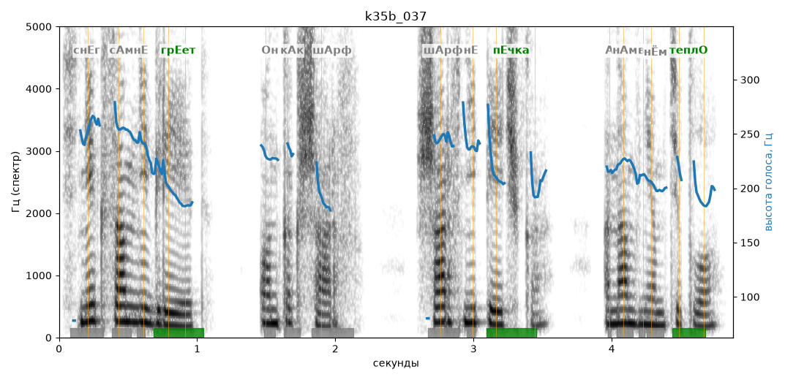

# k35b_037

Голос: **Барсик, сборка 35d** · длительность 4.9 с
Эталон: Снег сам не греет. Он как шарф. Шарф не печка, а нам в нём тепло.
Распознано: снег сам не греет, он как шарф, шарф не печка, а нам в нем тепло.
Слова: все совпали

## Ударения
(где нужно: ruaccent)

| слово | нужно | у голоса | |
|---|---|---|---|
| греет | грЕет | грЕет | ✓ |
| печка | пЕчка | пЕчка | ✓ |
| тепло | теплО | теплО | ✓ |

## Интонация
- ✓ «снег сам не греет.» — конец фразы понижается — звучит законченно
- ✓ «он как шарф.» — конец фразы понижается — звучит законченно
- ✓ «шарф не печка а нам в нём тепло.» — конец фразы понижается — звучит законченно
- Диапазон голоса 5.9 полутонов (нормально), средняя высота 221 Гц

## Паузы и темп
- паузы на своих местах
- Темп 5.8 слога/с (нормально)

_Синяя линия — высота голоса. Над словами заглавная буква — где ударение должно быть; красным — голос поставил не туда (уверенно), оранжевым — возможно._
