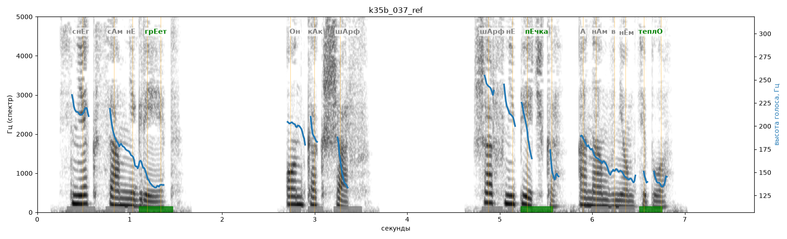

# k35b_037_ref

Голос: **edge:ru-RU-SvetlanaNeural** · длительность 7.8 с
Эталон: Снег сам не гре́ет. Он как шарф. Шарф не печка, а нам в нём тепло.
Распознано: снег сам не греет. Он как шарф. Шарф не печка, а нам в нем тепло.
Расхождения в словах: «гре ет» → «греет»

## Ударения
(где нужно: ruaccent)

| слово | нужно | у голоса | |
|---|---|---|---|
| греет | грЕет | грЕет | ✓ |
| печка | пЕчка | пЕчка | ✓ |
| тепло | теплО | теплО | ✓ |

## Интонация
- ✓ «снег сам не греет.» — конец фразы понижается — звучит законченно
- ✓ «он как шарф.» — конец фразы понижается — звучит законченно
- ✓ «шарф не печка а нам в нём тепло.» — конец фразы понижается — звучит законченно
- Диапазон голоса 9.4 полутонов (живо), средняя высота 170 Гц

## Паузы и темп
- паузы на своих местах
- Темп 5.1 слога/с (нормально)

_Синяя линия — высота голоса. Над словами заглавная буква — где ударение должно быть; красным — голос поставил не туда (уверенно), оранжевым — возможно._
