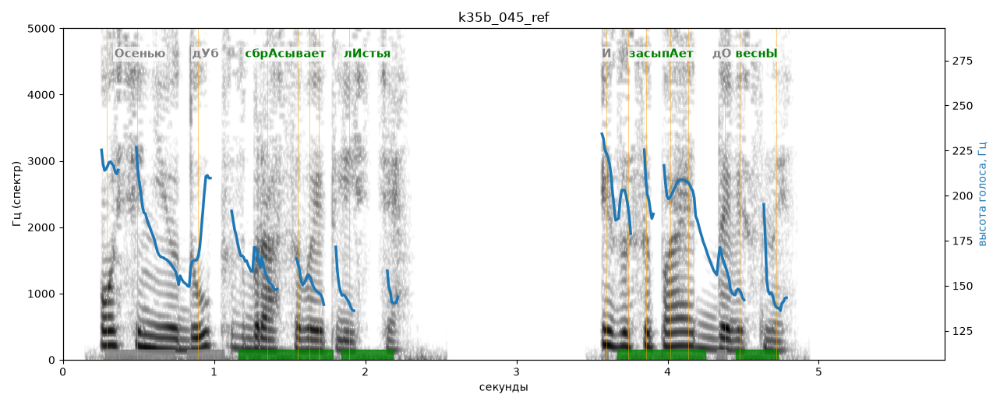

# k35b_045_ref

Голос: **edge:ru-RU-SvetlanaNeural** · длительность 5.8 с
Эталон: Осенью дуб сбрасывает листья. И засыпает до весны.
Распознано: Осенью Дуб сбрасывает листья. И засыпает довесны.
Расхождения в словах: «до весны» → «довесны»

## Ударения
(где нужно: ruaccent)

| слово | нужно | у голоса | |
|---|---|---|---|
| осенью | Осенью | — | ? |
| сбрасывает | сбрАсывает | сбрАсывает | ✓ |
| листья | лИстья | лИстья | ✓ |
| засыпает | засыпАет | засыпАет | ✓ |
| весны | веснЫ | веснЫ | ✓ |

## Интонация
- ✓ «осенью дуб сбрасывает листья.» — конец фразы понижается — звучит законченно
- ✓ «и засыпает до весны.» — конец фразы понижается — звучит законченно
- Диапазон голоса 7.6 полутонов (живо), средняя высота 165 Гц

## Паузы и темп
- паузы на своих местах
- Темп 5.3 слога/с (нормально)

_Синяя линия — высота голоса. Над словами заглавная буква — где ударение должно быть; красным — голос поставил не туда (уверенно), оранжевым — возможно._
