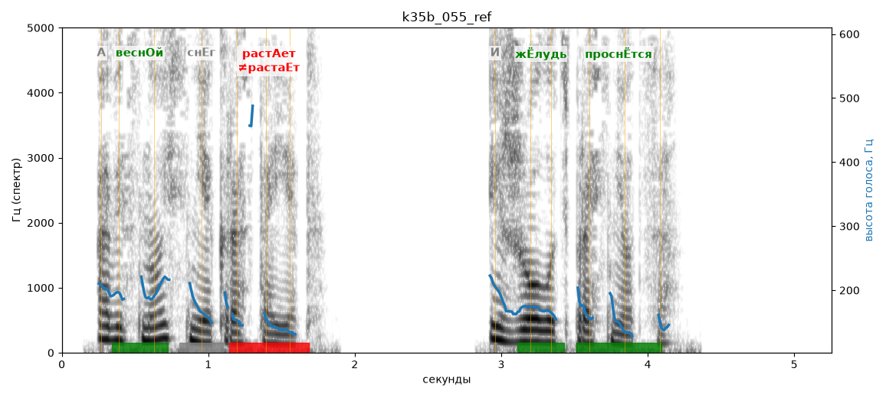

# k35b_055_ref

Голос: **edge:ru-RU-SvetlanaNeural** · длительность 5.3 с
Эталон: А весной снег раста́ет. И жёлудь проснётся.
Распознано: А весной снег растоет. И жёлоть проснётся.
Расхождения в словах: «раста ет» → «растоет»; «желудь» → «желоть»

## Ударения
(где нужно: ruaccent)

| слово | нужно | у голоса | |
|---|---|---|---|
| весной | веснОй | веснОй | ✓ |
| растает | растАет | растаЕт | ✗ ОШИБКА |
| жёлудь | жЁлудь | жЁлудь | ✓ |
| проснётся | проснЁтся | проснЁтся | ✓ |

## Интонация
- ✓ «а весной снег растает.» — конец фразы понижается — звучит законченно
- ✓ «и жёлудь проснётся.» — конец фразы понижается — звучит законченно
- Диапазон голоса 8.3 полутонов (живо), средняя высота 168 Гц

## Паузы и темп
- паузы на своих местах
- Темп 5.1 слога/с (нормально)

_Синяя линия — высота голоса. Над словами заглавная буква — где ударение должно быть; красным — голос поставил не туда (уверенно), оранжевым — возможно._
