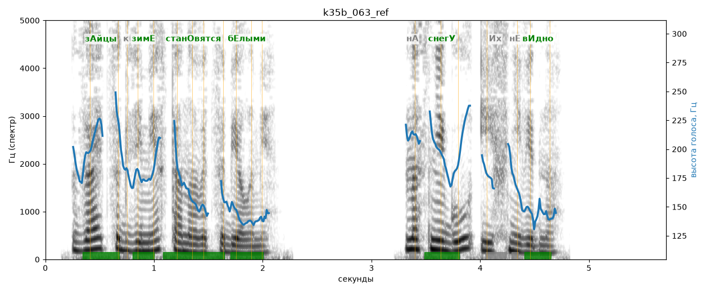

# k35b_063_ref

Голос: **edge:ru-RU-SvetlanaNeural** · длительность 5.7 с
Эталон: Зайцы к зиме становятся белыми. На снегу их не ви́дно.
Распознано: Зайца к земе становится белыми. На снегу их не видно.
Расхождения в словах: «зайцы» → «зайца»; «зиме становятся» → «земе становится»; «ви дно» → «видно»

## Ударения
(где нужно: ruaccent)

| слово | нужно | у голоса | |
|---|---|---|---|
| зайцы | зАйцы | зАйцы | ✓ |
| зиме | зимЕ | зимЕ | ✓ |
| становятся | станОвятся | станОвятся | ✓ |
| белыми | бЕлыми | бЕлыми | ✓ |
| снегу | снегУ | снегУ | ✓ |
| видно | вИдно | вИдно | ✓ |

## Интонация
- ✓ «зайцы к зиме становятся белыми.» — конец фразы понижается — звучит законченно
- ✓ «на снегу их не видно.» — конец фразы понижается — звучит законченно
- Диапазон голоса 8.4 полутонов (живо), средняя высота 174 Гц

## Паузы и темп
- паузы на своих местах
- Темп 7.0 слога/с (быстро)

_Синяя линия — высота голоса. Над словами заглавная буква — где ударение должно быть; красным — голос поставил не туда (уверенно), оранжевым — возможно._
