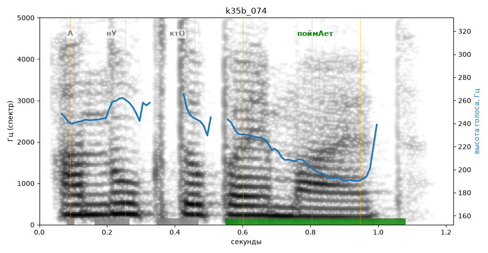

# k35b_074

Голос: **Барсик, сборка 35d** · длительность 1.2 с
Эталон: А ну, кто поймает?
Распознано: А ну кто поймает?
Слова: все совпали

## Ударения
(где нужно: ruaccent)

| слово | нужно | у голоса | |
|---|---|---|---|
| поймает | поймАет | поймАет | ✓ |

## Интонация
- ✗ «а ну кто поймает?» — нет вопросительного подъёма (самое высокое место — «ну», в начале) — звучит как утверждение
- Диапазон голоса 5.3 полутонов (нормально), средняя высота 230 Гц

## Паузы и темп
- паузы на своих местах
- Темп 6.0 слога/с (нормально)

_Синяя линия — высота голоса. Над словами заглавная буква — где ударение должно быть; красным — голос поставил не туда (уверенно), оранжевым — возможно._
