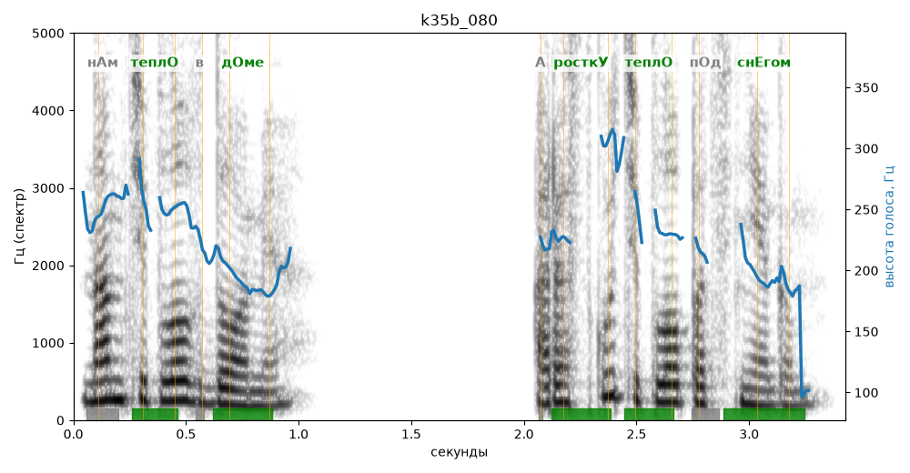

# k35b_080

Голос: **Барсик, сборка 35d** · длительность 3.4 с
Эталон: Нам тепло в доме. А ростку тепло под снегом.
Распознано: Нам тепло в доме, а раску тепло под снегом.
Расхождения в словах: «ростку» → «раску»

## Ударения
(где нужно: ruaccent)

| слово | нужно | у голоса | |
|---|---|---|---|
| тепло | теплО | теплО | ✓ |
| доме | дОме | дОме | ✓ |
| ростку | росткУ | росткУ | ✓ |
| тепло | теплО | теплО | ✓ |
| снегом | снЕгом | снЕгом | ✓ |

## Интонация
- ✓ «нам тепло в доме.» — конец фразы понижается — звучит законченно
- ✓ «а ростку тепло под снегом.» — конец фразы понижается — звучит законченно
- Диапазон голоса 8.5 полутонов (живо), средняя высота 225 Гц

## Паузы и темп
- паузы на своих местах
- Темп 7.0 слога/с (быстро)

_Синяя линия — высота голоса. Над словами заглавная буква — где ударение должно быть; красным — голос поставил не туда (уверенно), оранжевым — возможно._
