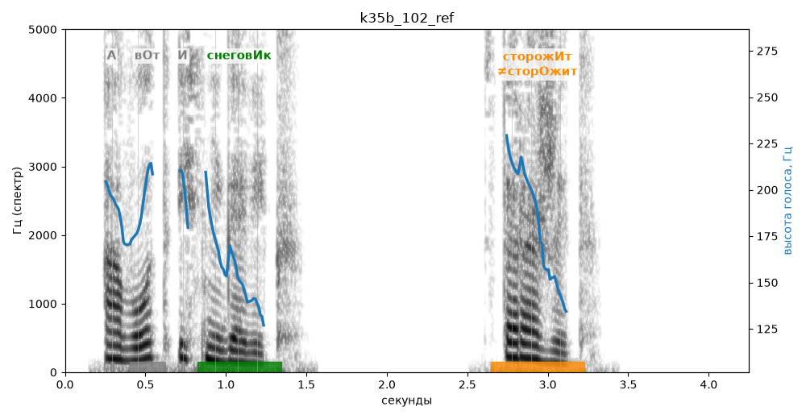

# k35b_102_ref

Голос: **edge:ru-RU-SvetlanaNeural** · длительность 4.2 с
Эталон: А вот и снеговик. Сторожит.
Распознано: А вот и снеговик. Старожит.
Расхождения в словах: «сторожит» → «старожит»

## Ударения
(где нужно: ruaccent)

| слово | нужно | у голоса | |
|---|---|---|---|
| снеговик | снеговИк | снеговИк | ✓ |
| сторожит | сторожИт | сторОжит | ✗? возможно — послушать |

## Интонация
- ✓ «а вот и снеговик.» — конец фразы понижается — звучит законченно
- ✓ «сторожит.» — конец фразы понижается — звучит законченно
- Диапазон голоса 7.6 полутонов (живо), средняя высота 175 Гц

## Паузы и темп
- паузы на своих местах
- Темп 5.5 слога/с (нормально)

_Синяя линия — высота голоса. Над словами заглавная буква — где ударение должно быть; красным — голос поставил не туда (уверенно), оранжевым — возможно._
