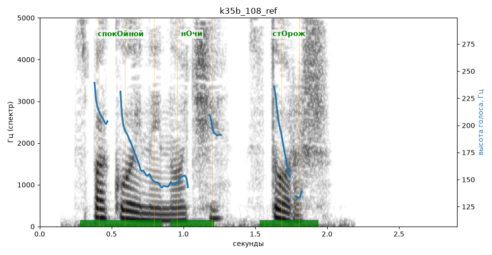

# k35b_108_ref

Голос: **edge:ru-RU-SvetlanaNeural** · длительность 2.9 с
Эталон: Спокойной ночи, сторож.
Распознано: Спокойной ночи, сторож.
Слова: все совпали

## Ударения
(где нужно: ruaccent)

| слово | нужно | у голоса | |
|---|---|---|---|
| спокойной | спокОйной | спокОйной | ✓ |
| ночи | нОчи | нОчи | ✓ |
| сторож | стОрож | стОрож | ✓ |

## Интонация
- ✗ «спокойной ночи сторож.» — конец фразы не понижается — звучит незаконченно / как перечисление
- Диапазон голоса 8.1 полутонов (живо), средняя высота 164 Гц

## Паузы и темп
- паузы на своих местах
- Темп 5.3 слога/с (нормально)

_Синяя линия — высота голоса. Над словами заглавная буква — где ударение должно быть; красным — голос поставил не туда (уверенно), оранжевым — возможно._
