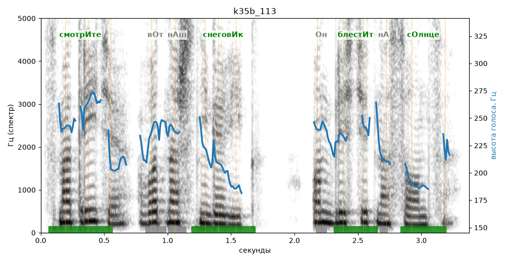

# k35b_113

Голос: **Барсик, сборка 35d** · длительность 3.4 с
Эталон: Смотрите, вот наш снеговик. Он блестит на солнце.
Распознано: Смотрите, вот наш снеговик. Он блестит на солнце.
Слова: все совпали

## Ударения
(где нужно: ruaccent)

| слово | нужно | у голоса | |
|---|---|---|---|
| смотрите | смотрИте | смотрИте | ✓ |
| снеговик | снеговИк | снеговИк | ✓ |
| блестит | блестИт | блестИт | ✓ |
| солнце | сОлнце | сОлнце | ✓ |

## Интонация
- ✓ «смотрите вот наш снеговик.» — конец фразы понижается — звучит законченно
- ✓ «он блестит на солнце.» — конец фразы понижается — звучит законченно
- Диапазон голоса 6.0 полутонов (нормально), средняя высота 229 Гц

## Паузы и темп
- паузы на своих местах
- Темп 5.9 слога/с (нормально)

_Синяя линия — высота голоса. Над словами заглавная буква — где ударение должно быть; красным — голос поставил не туда (уверенно), оранжевым — возможно._
