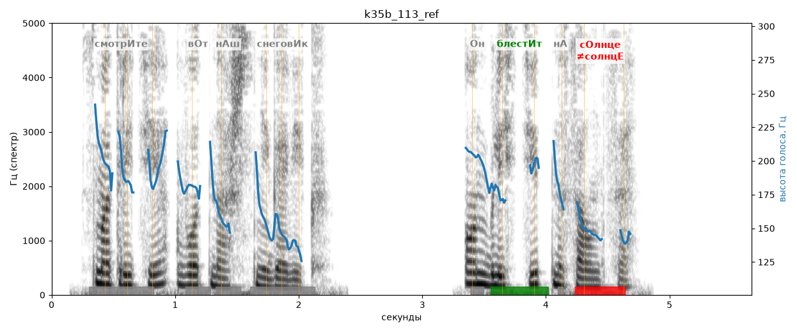

# k35b_113_ref

Голос: **edge:ru-RU-SvetlanaNeural** · длительность 5.7 с
Эталон: Смотри́те, вот наш снеговик. Он блестит на со́лнце.
Распознано: Смотрите вот наш снеговик. Он блестит на солнце.
Расхождения в словах: «смотри те» → «смотрите»; «со лнце» → «солнце»

## Ударения
(где нужно: ruaccent)

| слово | нужно | у голоса | |
|---|---|---|---|
| смотрите | смотрИте | смотритЕ | ? не разобрать |
| снеговик | снеговИк | снЕговик | ? не разобрать |
| блестит | блестИт | блестИт | ✓ |
| солнце | сОлнце | солнцЕ | ✗ ОШИБКА |

## Интонация
- ✓ «смотрите вот наш снеговик.» — конец фразы понижается — звучит законченно
- ✓ «он блестит на солнце.» — конец фразы понижается — звучит законченно
- Диапазон голоса 7.4 полутонов (живо), средняя высота 178 Гц

## Паузы и темп
- паузы на своих местах
- Темп 5.0 слога/с (нормально)

_Синяя линия — высота голоса. Над словами заглавная буква — где ударение должно быть; красным — голос поставил не туда (уверенно), оранжевым — возможно._
